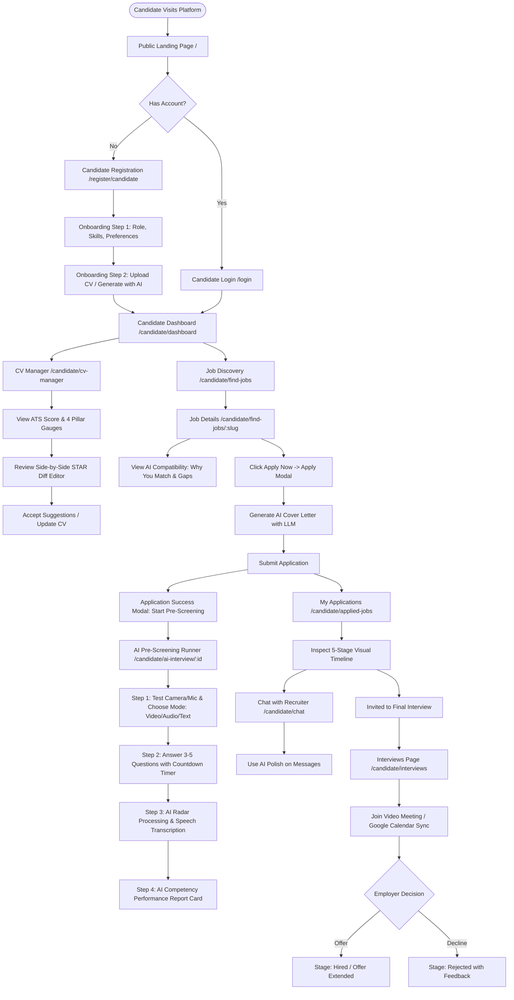
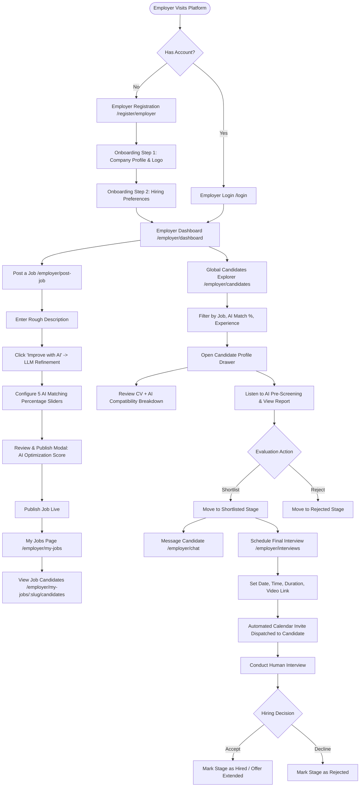
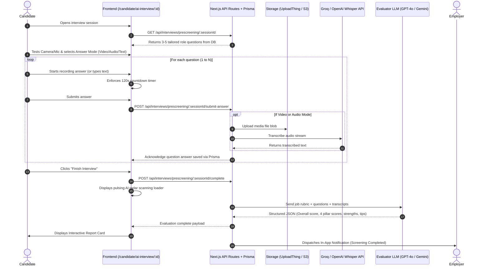
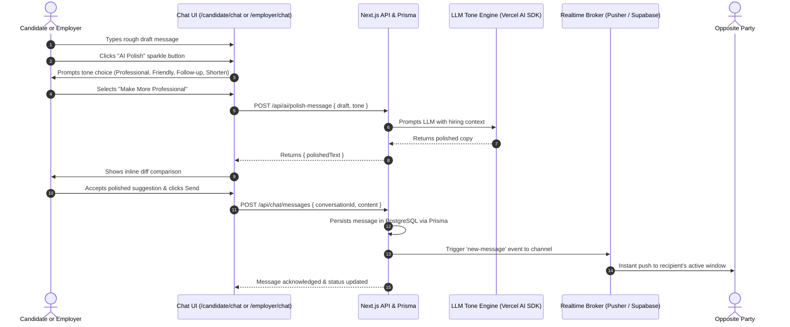
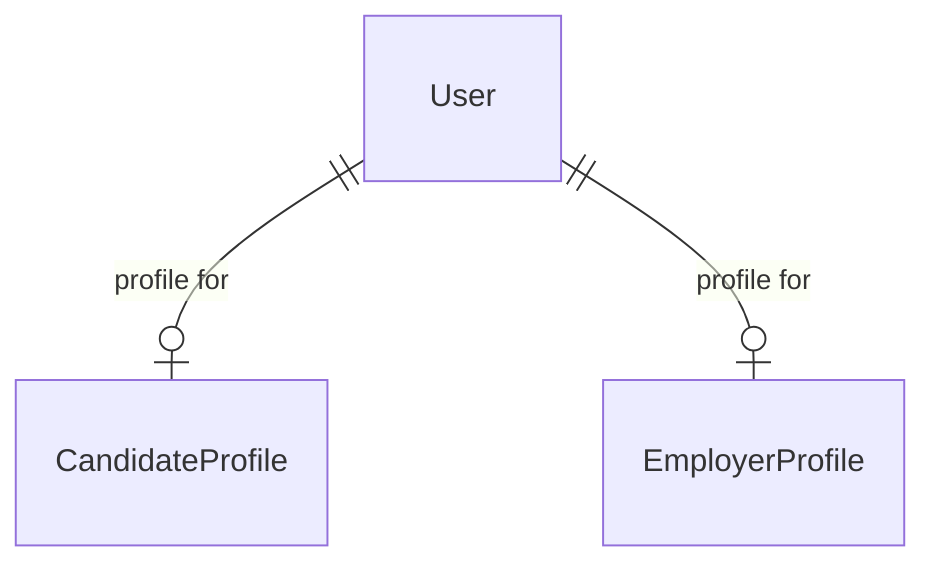

# AI Recruitment Platform — Master Project Requirements, User Flows & Full-Stack Next.js (Prisma + PostgreSQL) Specification

> **Document Status:** Unified Master Specification (Consolidating `client_requirement.md`, `CLIENT_REQUIREMENTS_GAP_AND_TASKS.md`, and `FULLSTACK_NEXTJS_PRISMA_SPECIFICATION.md`)  
> **Audience:** Full-Stack Next.js Engineering Team, Frontend & Backend Engineers, Product Managers, QA Engineers  
> **Tech Stack:**  
> - **Frontend & Application Layer:** Next.js 16 (App Router), React 19, TypeScript, Tailwind CSS v4, Ant Design 6, Zustand, React Hook Form (🟢 **100% Complete UI & Client State**)  
> - **Database & ORM:** Prisma ORM 7.x, PostgreSQL (Neon Serverless PostgreSQL via `@prisma/adapter-neon` with `DATABASE_URL_UNPOOLED` for migrations)  
> - **Backend Architecture:** Express-Style Layered Clean Architecture: Thin Next.js Route Handlers (`app/api/*`) ➔ Controllers (`server/controllers/*`) ➔ Services (`server/services/*`) ➔ Prisma Neon DB. Standard API responses via `lib/api-response.ts`. Auth via custom bcryptjs & session cookies. LLM & Speech capabilities via Vercel AI SDK, OpenAI / Gemini, Groq Whisper STT.

---

## Master Table of Contents

1. [Part I: Original Client Requirements & Platform Scope](#part-i-original-client-requirements--platform-scope)
   - [1.1 Platform Overview & Two-Sided Vision](#11-platform-overview--two-sided-vision)
   - [1.2 Candidate Side Core Specifications](#12-candidate-side-core-specifications)
   - [1.3 Employer Side Core Specifications](#13-employer-side-core-specifications)
   - [1.4 AI Capabilities Matrix](#14-ai-capabilities-matrix)
   - [1.5 End-to-End User Journeys (Client Specs)](#15-end-to-end-user-journeys-client-specs)
   - [1.6 Core Product Logic & Business Rules](#16-core-product-logic--business-rules)
   - [1.7 Navigation Specifications (Both Portals)](#17-navigation-specifications-both-portals)
2. [Part II: Implementation Status, Progress Scorecard & Task Tracker](#part-ii-implementation-status-progress-scorecard--task-tracker)
   - [2.1 Executive Summary Scorecard](#21-executive-summary-scorecard)
   - [2.2 Dual-Layer Task Tracker (Frontend Done vs. Full-Stack API Pending)](#22-dual-layer-task-tracker)
3. [Part III: End-to-End Visual User Flows (Mermaid Diagrams)](#part-iii-end-to-end-visual-user-flows)
   - [3.1 Candidate Master Flowchart](#31-candidate-master-flowchart)
   - [3.2 Employer Master Flowchart](#32-employer-master-flowchart)
   - [3.3 5-Stage Application State Machine](#33-5-stage-application-state-machine)
   - [3.4 AI Pre-Screening Interview Sequence](#34-ai-pre-screening-interview-sequence)
   - [3.5 Direct Messaging & AI Tone Polishing Sequence](#35-direct-messaging--ai-tone-polishing-sequence)
4. [Part IV: Page-by-Page Feature Specifications (Every Screen Explained)](#part-iv-page-by-page-feature-specifications)
   - [4.1 Public Marketing & Landing (`/`)](#41-public-marketing--landing)
   - [4.2 Authentication & Onboarding (Both Roles)](#42-authentication--onboarding)
   - [4.3 Candidate Portal (All 10 Pages)](#43-candidate-portal)
   - [4.4 Employer Portal (All 8 Pages)](#44-employer-portal)
   - [4.5 Cross-Portal Real-Time Chat & AI Message Assistant](#45-cross-portal-real-time-chat--ai-message-assistant)
   - [4.6 Global Notifications & Header Popover](#46-global-notifications--header-popover)
5. [Part V: Full-Stack Next.js Architecture & Production Prisma Schema (PostgreSQL)](#part-v-full-stack-nextjs-architecture--production-prisma-schema-postgresql)
   - [5.1 Recommended Next.js Full-Stack Directory Structure](#51-recommended-nextjs-full-stack-directory-structure)
   - [5.2 Database Entity Relationship Diagram (ERD)](#52-database-entity-relationship-diagram-erd)
   - [5.3 Production Prisma Schema (`prisma/schema.prisma`)](#53-production-prisma-schema-prismaschemaprisma)
6. [Part VI: Complete Next.js REST API Catalog & Route Handlers](#part-vi-complete-nextjs-rest-api-catalog--route-handlers)
   - [6.1 Authentication & Profile APIs](#61-authentication--profile-apis)
   - [6.2 Jobs & Faceted Search APIs](#62-jobs--faceted-search-apis)
   - [6.3 Applications & 5-Stage Timeline APIs](#63-applications--5-stage-timeline-apis)
   - [6.4 AI Pre-Screening Interview & Speech APIs](#64-ai-pre-screening-interview--speech-apis)
   - [6.5 Final Interviews & Scheduling APIs](#65-final-interviews--scheduling-apis)
   - [6.6 Real-Time Chat & Notifications APIs](#66-real-time-chat--notifications-apis)
   - [6.7 AI Broker Endpoints (LLM Prompts & Polishing)](#67-ai-broker-endpoints)
7. [Part VII: AI & Machine Learning Service Contracts](#part-vii-ai--machine-learning-service-contracts)
8. [Part VIII: Full-Stack Integration Checklist & Development Protocol](#part-viii-full-stack-integration-checklist--development-protocol)

---

# Part I: Original Client Requirements & Platform Scope

### 1.1 Platform Overview & Two-Sided Vision
The platform is an AI-powered recruitment web application connecting **Candidates (job seekers)** with **Employers (companies/HR)**. AI supports CV improvement, semantic job matching, candidate ranking, pre-screening interviews, soft skills analysis, and professional communication. The Employer makes the final hiring decision.

---

### 1.2 Candidate Side Core Specifications
* **Core Candidate Journey:**  
  Create Profile ➔ Upload CV ➔ Improve CV with AI ➔ Find Jobs ➔ Apply with AI Cover Letter ➔ AI Pre-Screening ➔ Track Application Timeline ➔ Final Interview ➔ Job Offer.
* **Authentication & Account:**
  - Welcome / Landing — Value proposition, "Get Started" and "Log In" CTAs.
  - Sign Up — Full Name, Email, Password, Confirm Password; Continue with Google/LinkedIn.
  - Login — Email, Password, Remember Me, Forgot Password.
  - Candidate Onboarding — Job Title/Role, Skills, Experience Level, Preferred Location, Work Type (`Remote`, `Hybrid`, `On-site`), Salary Expectation, Bio.
* **Dashboard:**
  - Personalized Greeting (*"Good morning, [Name]"*).
  - 4 Overview Metric Cards: Recommended Jobs, Applications, Shortlisted, Interviews.
  - Recommended Jobs feed: Job Title, Company, Location, Employment Type, AI Match Score, View Job, Apply Now.
* **CV Management (`/candidate/cv-manager`):**
  - View, Edit, Download, Replace, Improve with AI, Generate CV with AI.
  - Upload CV: Supported PDF/DOCX up to 10MB.
  - AI CV Analysis: Analyze skills, experience, keywords, formatting and job relevance; show ATS CV score and improvement suggestions.
  - AI CV Improvement: Side-by-side Original CV vs AI Improved CV (STAR format); Accept Suggestion, Edit Manually, Save Updated CV.
* **Job Discovery & Application (`/candidate/find-jobs`):**
  - Search jobs by keywords, skills, or companies. Faceted filters: Job Type, Location, Experience, Salary, Remote/Hybrid/On-site.
  - Recommended Jobs: AI recommendations based on CV, skills, experience, and preferences.
  - Job Details (`/candidate/find-jobs/[job_slug]`): Title, company, employment type, location, full description, responsibilities, requirements, AI Match Score, *"Why you match"*, *"Potential gaps"*, Apply Now, Save Job.
  - Apply for Job Modal: Select active CV or upload new, Generate/Edit AI Cover Letter, review application summary, Submit Application.
  - Application Submitted Confirmation: Prompts candidate to start the AI Pre-Screening Interview or track in My Applications.
* **AI Pre-Screening Interview (`/candidate/ai-interview`):**
  - Introduction explaining that the short interview helps employers assess skills, experience, and communication.
  - Device test: Camera & microphone preview with mode selection: **Record Video**, **Record Audio**, or **Type Answer**.
  - Question Runner: 3-5 role-related questions with active countdown timer.
  - Interview Processing: Pulsing animation while speech transcription and scoring occur.
  - AI Interview Report: Communication, Confidence, Problem Solving, Teamwork, and Overall Score (0-100) with actionable improvement tips.
* **Application Tracking & Communication:**
  - My Applications (`/candidate/applied-jobs`): Filter tabs: `All`, `Under Review`, `Shortlisted`, `Interview`, `Hired / Offer`, `Archived`.
  - 5-Stage Interactive Timeline: Application Submitted ➔ AI Pre-Screening Completed ➔ Employer Review ➔ Final Interview ➔ Hiring Decision.
  - Direct Messages (`/candidate/chat`): Professional messaging with AI Message Assistant polish.
  - Interviews (`/candidate/interviews`): Upcoming interviews, date/time, details, Join Interview, Google Calendar sync, Request Reschedule.
  - Notifications: Top header popover for application viewed, shortlisted, interview invites, new matching jobs.
  - Profile (`/candidate/profile`): Personal info, professional summary, experience, education, certifications, skills, CV, AI profile strength score, preferences.

---

### 1.3 Employer Side Core Specifications
* **Core Employer Journey:**  
  Company Setup ➔ Post Job with AI ➔ AI Matching Configuration ➔ Publish Job ➔ Receive Applications ➔ AI Candidate Ranking ➔ Review Candidate Profile & AI Report ➔ Shortlist ➔ Message via Chat ➔ Schedule Final Interview ➔ Final Interview ➔ Hiring Decision.
* **Authentication & Company Setup:**
  - Employer Signup (`/register/employer`) — HR Name, Company Name, Work Email, Password.
  - Company Onboarding (`/onboarding/employer`) — Company Name, Logo upload, Industry, Company Size, Website, Location, Hiring Preferences.
* **Dashboard (`/employer/dashboard`):**
  - Overview Cards: Active Jobs, Total Applicants, AI Recommended Candidates, Shortlisted, Interviews Scheduled.
  - Hiring Pipeline Funnel conversion chart.
  - Recent Jobs Feed: Title, applicant count, top AI match score, status badge (`Active`/`Draft`/`Closed`).
* **Job Management (`/employer/my-jobs`):**
  - Tabs: `All`, `Active`, `Draft`, `Closed`. Search and faceted filters.
  - Job Actions: View Details, Edit Job, View Candidates, Duplicate, Close Job, Delete.
* **Post a Job (`/employer/post-job`):**
  - Title, Department, Employment Type, Location, Work Type (`Remote`, `Hybrid`, `On-site`), Experience Level, Salary Range.
  - Job Description: Employer enters notes; *"Improve with AI"* converts rough copy into structured, professional job content.
  - Interactive Responsibilities & Skills Tag Builders.
  - **AI Matching Configuration (5 Percentage Sliders summing to 100%):**
    - Skills Weight (default 30%)
    - Experience Weight (default 25%)
    - Job Requirements Weight (default 20%)
    - Education Weight (default 15%)
    - Soft Skills Weight (default 10%)
  - Review & Publish Modal: Displays AI Optimization Score badge (e.g. `94/100`), strengths, recommendations, and Publish CTA.
* **Candidate Management (`/employer/candidates`):**
  - Tabs: `All Candidates`, `AI Recommended (85%+)`, `Shortlisted`, `Interview`, `Rejected`.
  - Filters: Job Role, Match Score Range, Experience, Skills.
  - AI Ranked Candidate Cards: Name, avatar, AI Match Score, experience, skills, soft skills mini-bars, date, status.
  - Candidate Profile Drawer / View: Full CV preview, AI Compatibility breakdown (*"Why they match"* and *"Potential gaps"*), AI Pre-Screening Interview report with video/audio replay and transcripts, stage transition buttons.
* **Communication & Final Interviews (`/employer/interviews`):**
  - Schedule Final Interview Modal: Select candidate, job reference, date, time, duration (15/30/45/60 min), interview type (Video/Phone/In-Person), meeting link, invitation message.
  - Automated ICS calendar email dispatched to candidate.
  - Tabs: `Upcoming`, `Completed`, `Cancelled` with reschedule and cancel actions.
* **Employer Settings (`/employer/settings/*`):**
  - Company Profile: Edit logo, company name, website, industry, description.
  - Account & Security: Email, password change, active sessions.
  - Notifications: Email and in-app alerts for applications, high-match candidates, interview acceptances.
  - AI Settings (`/employer/settings/ai`): Minimum match score threshold slider (default 85%), auto-trigger AI pre-screening toggle, AI Assistant tone selector (`Professional`, `Friendly`, `Direct`).

---

### 1.4 AI Capabilities Matrix
1. **Candidate CV Analysis & ATS Scoring:** Parsing PDF/DOCX to compute scores across Formatting, Role Relevance, Impact, and Keywords.
2. **AI CV Improvement:** Side-by-side STAR format bullet point rewriter.
3. **AI Job Recommendations & Semantic Matching:** Calculating candidate-to-job compatibility.
4. **AI Cover Letter Assistance:** Generating personalized 3-paragraph letters based on CV and job specs.
5. **AI Pre-Screening Interview Runner:** Dynamic questions tailored to the role.
6. **Speech-to-Text & Soft Skills Analysis:** Transcribing audio/video with Whisper and scoring Communication, Confidence, Problem Solving, and Teamwork.
7. **Employer Candidate Ranking:** Ranking candidate applications based on the job's 5 custom weights.
8. **AI Compatibility Insights:** Generating *"Why you match"* and *"Potential gaps"* breakdowns.
9. **AI Job Description Optimization:** Enhancing recruiter drafts into polished job posts.
10. **AI Message Polish Assistant:** Refining chat messages into professional, friendly, or concise formats.

---

### 1.5 End-to-End User Journeys (Client Specs)
* **Final End-to-End Candidate Flow:**  
  Sign Up ➔ Profile Setup ➔ Upload / Generate CV ➔ AI CV Improvement ➔ Find / Recommended Jobs ➔ Job Details ➔ Apply ➔ AI Cover Letter ➔ Application Submitted ➔ AI Pre-Screening Interview ➔ AI Interview Analysis ➔ Application Tracking ➔ Employer Review ➔ Shortlisted ➔ Direct Message ➔ Final Interview ➔ Employer Hiring Decision.
* **Final End-to-End Employer Flow:**  
  Sign Up ➔ Company Setup ➔ Dashboard ➔ Post Job ➔ AI Job Description Optimization ➔ AI Matching Configuration ➔ Publish Job ➔ Candidates Apply ➔ AI Candidate Ranking ➔ Candidate Profile ➔ AI Compatibility Analysis ➔ Soft Skills Analysis ➔ Shortlist ➔ Message Candidate ➔ Schedule Final Interview ➔ Final Interview ➔ Hiring Decision.

---

### 1.6 Core Product Logic & Business Rules
* AI recommends, analyzes, ranks, and assists; **it does NOT make the final hiring decision**.
* The final interview is conducted by human hiring managers / HR.
* The final hire or rejection decision belongs exclusively to the employer.
* Pre-screening interviews happen before the final employer interview.
* Messaging remains hiring-focused, with AI assistance rather than automated bot replies.

---

### 1.7 Navigation Specifications (Both Portals)

#### Suggested Employer Navigation (`components/layouts/dashboard-sidebar.tsx`)
- `Dashboard` (`/employer/dashboard`)
- `My Jobs` (`/employer/my-jobs`)
- `Candidates` (`/employer/candidates`)
- `Post a Job` (`/employer/post-job`)
- `Interviews` (`/employer/interviews`)
- `Messages` (`/employer/chat`)
- `Settings` (`/employer/settings`)

#### Suggested Candidate Navigation (`components/layouts/dashboard-sidebar.tsx`)
- `Dashboard` (`/candidate/dashboard`)
- `Find Jobs` (`/candidate/find-jobs`)
- `My Applications` (`/candidate/applied-jobs`)
- `Interviews` (`/candidate/interviews`)
- `Saved Jobs` (`/candidate/saved-jobs`)
- `AI Interview` (`/candidate/ai-interview`)
- `CV Manager` (`/candidate/cv-manager`)
- `Profile` (`/candidate/profile`)
- `Messages` (`/candidate/chat`)
- `Settings` (`/candidate/settings`)

---

# Part II: Implementation Status, Progress Scorecard & Task Tracker

### 2.1 Executive Summary Scorecard

| Module / Feature Area | Static UI Status | Full-Stack API Status | Readiness Assessment |
| :--- | :--- | :--- | :--- |
| **Auth & Onboarding (Candidate & Employer)** | 🟢 **100% Complete** | 🔴 **Pending** | Forms, validation, dropzones ready; ready for Better Auth / NextAuth & Prisma |
| **Candidate Dashboard (`/candidate/dashboard`)** | 🟢 **100% Complete** | 🔴 **Pending** | UI complete with stats, pipeline, AI matches; ready for aggregation Route Handler |
| **Candidate Job Discovery (`/candidate/find-jobs`)**| 🟢 **100% Complete** | 🔴 **Pending** | Keyword search, faceted filter sidebar complete; ready for Prisma search query |
| **Job Details & Apply Modal (`[job_slug]`)** | 🟢 **100% Complete** | 🔴 **Pending** | Full specs, AI cover letter generator ready; needs application creation Route Handler |
| **Candidate Applications (`/candidate/applied-jobs`)**| 🟢 **100% Complete** | 🔴 **Pending** | 5-stage timeline visual, document modals ready; needs Prisma status tracking API |
| **Candidate CV Manager (`/candidate/cv-manager`)** | 🟢 **100% Complete** | 🔴 **Pending** | ATS score gauge, STAR diff editor complete; ready for Vercel AI SDK parser |
| **Candidate AI Pre-Screening (`/candidate/ai-interview`)**| 🟢 **100% Complete**| 🔴 **Pending**| Camera/mic check, runner, radar loader, report ready; needs Groq Whisper & LLM API |
| **Candidate Scheduled Interviews (`/candidate/interviews`)**| 🟢 **100% Complete**| 🔴 **Pending**| Tabs, cards, calendar sync, reschedule ready; needs calendar Route Handler |
| **Candidate Saved Jobs (`/candidate/saved-jobs`)** | 🟢 **100% Complete** | 🔴 **Pending** | Cards and salary benchmark widget complete; needs Prisma bookmarking API |
| **Candidate Profile (`/candidate/profile`)** | 🟢 **100% Complete** | 🔴 **Pending** | Forms and 3 history modals complete; needs candidate Prisma CRUD |
| **Candidate Settings (`/candidate/settings/*`)** | 🟢 **100% Complete** | 🔴 **Pending** | Security, Notifications, Privacy tabs complete; needs settings Route Handler |
| **Employer Dashboard (`/employer/dashboard`)** | 🟢 **100% Complete** | 🔴 **Pending** | Metric cards, funnel chart, recent jobs ready; needs metrics aggregation API |
| **Employer Post Job (`/employer/post-job`)** | 🟢 **100% Complete** | 🔴 **Pending** | 5 weight sliders, AI optimizer, review modal ready; needs job creation Route Handler |
| **Employer My Jobs (`/employer/my-jobs`)** | 🟢 **100% Complete** | 🔴 **Pending** | Tabs, filters, candidate lists ready; needs Prisma job management API |
| **Employer Candidates Explorer (`/employer/candidates`)**| 🟢 **100% Complete**| 🔴 **Pending**| Global explorer, match score cards, evaluation drawer ready; needs ranking API |
| **Employer Interview Scheduling (`/employer/interviews`)**| 🟢 **100% Complete**| 🔴 **Pending**| Schedule modal with 3 types, tabs ready; needs interview Route Handler |
| **Employer Settings (`/employer/settings/*`)** | 🟢 **100% Complete** | 🔴 **Pending** | Company, Security, Notifications, AI Settings ready; needs settings API |
| **Cross-Portal Messaging (`/candidate/chat` & `/employer/chat`)**| 🟢 **100% Complete**| 🔴 **Pending**| Two-pane chat, thread list, AI message polish tool ready; needs Pusher / Supabase Realtime |
| **Global Header Notifications** | 🟢 **100% Complete** | 🔴 **Pending** | Notification dropdown, read/unread filters ready; needs notification Route Handler |

---

### 2.2 Dual-Layer Task Tracker

#### Layer A: Static UI & Interactive Frontend Presentation (STATUS: 🟢 100% COMPLETE)
- [x] Candidate & Employer Auth forms with validation (`/register/*`, `/login`, `/forgot-password`).
- [x] Candidate Onboarding (Preferences & CV upload dropzone).
- [x] Employer Onboarding (Company profile & hiring preferences).
- [x] Candidate Dashboard with greeting, metrics, pipeline bar, and AI matches.
- [x] Candidate Job Discovery with debounced search, faceted sidebar, and bookmarks.
- [x] Job Details page with AI match insights, apply modal, and AI cover letter generator.
- [x] Applications page with 5-stage interactive visual timeline and withdraw modal.
- [x] CV Manager with ATS gauge (4 pillars), side-by-side STAR diff editor, and AI builder.
- [x] AI Pre-Screening Interview (Device check, question runner with timer, radar loader, score report).
- [x] Candidate Scheduled Interviews with Google Calendar sync and reschedule modal.
- [x] Candidate Profile with avatar upload and 3 modular modals (Experience, Education, Certifications).
- [x] Candidate Settings with sub-routes for Security, Notifications, and Privacy.
- [x] Employer Dashboard with metrics cards, funnel chart, and recent jobs.
- [x] Employer Post Job with "Improve with AI", 5 percentage weight sliders, and review modal.
- [x] Employer My Jobs with tabs, filters, job details, and candidate list under job.
- [x] Employer Candidates Explorer with global filtering, match score badges, and evaluation drawer.
- [x] Employer Interviews with schedule modal (video/phone/in-person), tabs, and cancel modal.
- [x] Employer Settings with Company Profile, Security, Notifications, and AI Settings tab.
- [x] Cross-Portal Real-time Chat with conversation list, message bubbles, context panel, and AI tone polisher.
- [x] Global Header Notifications dropdown with filter tabs and deep links.
- [x] Sidebar navigation links synchronized across candidate and employer portals.
- [x] Architectural compliance with `AGENTS.md` (types organized in root `@/types/`, no local types).

#### Layer B: Full-Stack Next.js & Prisma Implementation (STATUS: 🔴 PENDING — FOR FULLSTACK INTEGRATION)
- [ ] **Prisma & Database Setup:** Prisma ORM 6.x, PostgreSQL (Neon / Supabase / Local PostgreSQL), schema migration, seed data.
- [ ] **Authentication & Session:** Better Auth / NextAuth.js (Auth.js v5) with Credentials & OAuth (Google/LinkedIn), role-based middleware (`/candidate/*`, `/employer/*`).
- [ ] **Candidate & Profile API:** Prisma CRUD for CandidateProfile, WorkExperience, Education, Certification, and CV records.
- [ ] **Employer & Company API:** Prisma CRUD for EmployerProfile, Company settings, and team data.
- [ ] **Jobs API:** Prisma queries for Jobs CRUD, faceted multi-attribute filters, 5-weight AI matching formula calculation.
- [ ] **Applications API:** Submit application, 5-stage lifecycle state engine (`applied` ➔ `ai_prescreening` ➔ `employer_review` ➔ `interview` ➔ `hired`).
- [ ] **AI Pre-Screening API:** Groq Whisper STT audio transcription, question dynamic prompt generation, GPT-4o / Gemini scoring rubric.
- [ ] **Interviews & Calendar API:** Final interview booking, ICS calendar file generation, rescheduling endpoints.
- [ ] **Real-Time Chat & Notifications:** Pusher Channels / Supabase Realtime for instant messaging and unread notification alerts.
- [ ] **AI Services Broker:** Vercel AI SDK route handlers for STAR bullet rewriting, job description optimization, cover letter generation, tone polishing.
- [ ] **Storage Integration:** UploadThing / Cloudinary / AWS S3 for CV PDFs and interview media recordings.

---

# Part III: End-to-End Visual User Flows

### 3.1 Candidate Master Flowchart



---

### 3.2 Employer Master Flowchart



---

### 3.3 5-Stage Application State Machine

```mermaid
stateDiagram-v2
    [*] --> Stage1_Submitted: Candidate submits application with active CV & cover letter
    
    Stage1_Submitted --> Stage2_AIPrescreening: System or candidate triggers AI Pre-Screening
    Stage2_AIPrescreening --> Stage3_EmployerReview: Candidate completes answers; AI report generated
    
    Stage1_Submitted --> Stage3_EmployerReview: If job does not require AI pre-screening
    
    Stage3_EmployerReview --> Stage4_FinalInterview: Employer reviews evaluation and books final interview
    Stage3_EmployerReview --> Rejected: Employer rejects application
    
    Stage4_FinalInterview --> Stage5_HiringDecision: Final interview conducted
    Stage4_FinalInterview --> Rejected: Employer decides not to move forward
    
    Stage5_HiringDecision --> Hired: Formal offer extended and recorded
    Stage5_HiringDecision --> Rejected: Final rejection
    
    Stage1_Submitted --> Withdrawn: Candidate voluntarily withdraws
    Stage2_AIPrescreening --> Withdrawn: Candidate voluntarily withdraws
    Stage3_EmployerReview --> Withdrawn: Candidate voluntarily withdraws
    Stage4_FinalInterview --> Withdrawn: Candidate voluntarily withdraws
```



---

### 3.4 AI Pre-Screening Interview Sequence



---

### 3.5 Direct Messaging & AI Tone Polishing Sequence



---

# Part IV: Page-by-Page Feature Specifications

### 4.1 Public Marketing & Landing (`/`)
* **Route:** `app/(marketing)/page.tsx`
* **Features:**
  - Hero banner with dynamic call-to-actions: *"Find Jobs with AI"* (routes to `/candidate/find-jobs`) and *"Hire Top Talent"* (routes to `/register/employer`).
  - Key Statistics strip (95% Matching Accuracy, 3x Faster Hiring).
  - AI Capability Spotlights (CV Analysis, Weighted Ranking, Pre-Screening, Direct Chat).
  - Social Proof, Testimonials, and Company Trust Logos.
  - Header Navigation with Login & Registration buttons.

---

### 4.2 Authentication & Onboarding

#### Candidate Registration (`/register/candidate`)
* **Route:** `app/(auth)/register/candidate/page.tsx`
* **Form Fields:** `fullName`, `email`, `password`, `confirmPassword`.
* **Features:** Real-time password match validation, Google and LinkedIn social OAuth buttons. Generates JWT tokens and redirects to `/onboarding/candidate`.

#### Employer Registration (`/register/employer`)
* **Route:** `app/(auth)/register/employer/page.tsx`
* **Form Fields:** `hrName`, `companyName`, `workEmail`, `password`, `confirmPassword`.
* **Features:** Work email validation, social auth buttons. Generates JWT tokens and redirects to `/onboarding/employer`.

#### Unified Login (`/login`)
* **Route:** `app/(auth)/login/page.tsx`
* **Form Fields:** `email`, `password`, `rememberMe`.
* **Features:** Unified authentication endpoint verifying user role and routing candidates to `/candidate/dashboard` and employers to `/employer/dashboard`.

#### Candidate Onboarding Wizard (`/onboarding/candidate`)
* **Route:** `app/(onboarding)/onboarding/candidate/page.tsx`
* **Step 1: Career Preferences:**
  - `jobTitle` (text), `experienceLevel` (dropdown: Entry, Mid, Senior, Lead, Executive).
  - `workType` toggle cards: `Remote`, `Hybrid`, `On-site`.
  - `preferredLocation` (text), `salaryExpectation` (number), `skills` (interactive tag chip selector), `bio` (textarea).
* **Step 2: Resume / CV Setup:**
  - Interactive file dropzone accepting PDF/DOCX (max 10MB).
  - Alternative card: *"Generate CV with AI"*.
  - Submits to `PUT /api/candidate/onboarding/`.

#### Employer Onboarding Wizard (`/onboarding/employer`)
* **Route:** `app/(onboarding)/onboarding/employer/page.tsx`
* **Step 1: Company Profile:**
  - `companyName`, `website`, `industry`, `companySize` (`1-10`, `11-50`, `51-200`, `201-500`, `500+`), `location`.
  - Company Logo file uploader with instant image preview.
* **Step 2: Hiring Preferences:**
  - `primaryRoles` (tags), `workPolicy` (`Remote-first`, `Hybrid`, `Office-based`), `hiringSpeed`.
  - Submits to `PUT /api/employer/onboarding/`.

---

### 4.3 Candidate Portal (All 10 Pages)

#### 1. Candidate Dashboard (`/candidate/dashboard`)
* **Route:** `app/(candidate)/candidate/dashboard/page.tsx`
* **Components:** Greeting banner, 4 KPI cards (Recommended Jobs, Applications Submitted, Shortlisted, Upcoming Interviews), Pipeline Funnel progress visualizer, Top 4 Recommended Jobs grid with match score badges, Recent Activity timeline.

#### 2. Job Discovery & Search (`/candidate/find-jobs`)
* **Route:** `app/(candidate)/candidate/find-jobs/page.tsx`
* **Components:** Debounced keyword search input, Faceted Filter Sidebar (Work Type, Experience Level, Salary Range dual-slider, Minimum Match Score slider, Department), Active filter chips with "Clear All", Responsive Job Cards list with match percentage pill, salary, and bookmark toggle.

#### 3. Job Details & Application Modal (`/candidate/find-jobs/[job_slug]`)
* **Route:** `app/(candidate)/candidate/find-jobs/[job_slug]/page.tsx`
* **Components:** Job title, company logo, salary, location, work type, Full Job Description, Responsibilities list, Requirements list, AI Compatibility Gauge (e.g. `92%`), *"Why You Match"* accordion, *"Potential Gaps"* accordion, Sticky Action Bar with "Save Job" and "Apply Now".
* **Apply Modal (`JobApplyModal`):** Choose profile CV with ATS score badge, **AI Cover Letter Generator** (drafts personalized letter), Submit Application CTA.
* **Success Dialog:** Prompts candidate to start the AI Pre-Screening Interview or view in My Applications.

#### 4. My Applications & 5-Stage Timeline (`/candidate/applied-jobs`)
* **Route:** `app/(candidate)/candidate/applied-jobs/page.tsx`
* **Components:** Filter tabs (`All`, `Under Review`, `Shortlisted`, `Interview`, `Hired / Offer`, `Archived`) with live counts, search and sort controls, Application cards with **Interactive 5-Stage Visual Timeline** (`applied`, `ai_prescreening`, `employer_review`, `interview`, `hired`), Document Preview modal, Withdraw Application confirmation modal.

#### 5. CV Manager & STAR Diff Editor (`/candidate/cv-manager`)
* **Route:** `app/(candidate)/candidate/cv-manager/page.tsx`
* **Components:** Active CV Overview card (file name, upload date, download PDF, Replace CV modal), **ATS Score Gauge** (`86/100`) with 4 Pillar Progress Bars (Formatting, Role Relevance, Impact Metrics, Keyword Optimization), Missing High-Demand Keyword tags (click to add), **Side-by-Side STAR Diff Editor** (Original vs AI-Improved bullet points with "Accept", "Edit Manually", "Dismiss", and "Accept All Pending"), **AI CV Generator Modal**.

#### 6. AI Pre-Screening Interview (`/candidate/ai-interview` & `[id]`)
* **Route:** `app/(candidate)/candidate/ai-interview/[id]/page.tsx`
* **Components:**
  - **Step 1: Welcome & Device Check:** Camera/Mic live test with audio visualizer bar, Answer Mode Selector (**Video Recording**, **Audio Recording**, **Written Text**).
  - **Step 2: Question Runner:** Question cards with AI text-to-speech audio reader, countdown timer (120s max), recording waveforms, Start/Pause/Re-record controls, character counter for text mode.
  - **Step 3: AI Processing State:** Pulsing radar loader simulating speech-to-text and scoring analysis.
  - **Step 4: AI Performance Report:** Overall Score Gauge (`88/100`), 4 Competency Score Bars (Communication, Confidence, Problem Solving, Teamwork), Key Strengths list, Actionable Improvement Tips for human interview.

#### 7. Candidate Scheduled Interviews (`/candidate/interviews`)
* **Route:** `app/(candidate)/candidate/interviews/page.tsx`
* **Components:** Filter tabs (`All`, `Upcoming`, `Completed`, `Cancelled`), Next Interview Alert banner with quick "Join Meeting" CTA, Interview meeting cards with company logo, interview round name, date/time, duration, interviewer panelists, meeting link, "Add to Google Calendar", and "Request Reschedule" modal.

#### 8. Candidate Saved Jobs (`/candidate/saved-jobs`)
* **Route:** `app/(candidate)/candidate/saved-jobs/page.tsx`
* **Components:** Saved job cards with match scores, salary, and company info, **Salary Benchmark Comparison Widget** showing market averages, Apply CTA, Remove Bookmark button.

#### 9. Candidate Profile (`/candidate/profile`)
* **Route:** `app/(candidate)/candidate/profile/page.tsx`
* **Components:** Avatar photo uploader with camera icon, Profile strength meter, Personal & Contact Information form, Career Preferences form, Skills & Competencies with proficiency tags, 3 Modular Cards with Add/Edit Modals (**Work Experience**, **Education**, **Certifications**), Verified Resume preview.

#### 10. Candidate Settings (`/candidate/settings/*`)
* **Route:** `app/(candidate)/candidate/settings/[tab]/page.tsx`
* **Subpages:**
  - `/candidate/settings/security`: Contact email, SMS recovery, `ChangePasswordForm` with strength checklist, Active sessions with remote logout, `DangerZone` (Logout, Delete Account).
  - `/candidate/settings/notifications`: Channel toggles (Email, Push, In-App), Recruiter communication toggles, AI Job Match threshold slider, frequency radio cards (`Instant`, `Daily`, `Weekly`).
  - `/candidate/settings/privacy`: Recruiter discovery mode (`Public`, `Discreet`, `Private`), Blocked Companies exclusion list, AI Training opt-out, Data Export (JSON).

---

### 4.4 Employer Portal (All 8 Pages)

#### 1. Employer Dashboard (`/employer/dashboard`)
* **Route:** `app/(employer)/employer/dashboard/page.tsx`
* **Components:** Personalized greeting, 5 Metric Overview Cards (Active Jobs, Total Applicants, AI Recommended, Shortlisted, Interviews Scheduled), Hiring Pipeline Funnel conversion visualizer, Recent Jobs feed with applicant tallies and top match scores, Quick action buttons.

#### 2. Job Management (`/employer/my-jobs`)
* **Route:** `app/(employer)/employer/my-jobs/page.tsx`
* **Components:** Filter tabs (`All`, `Active`, `Draft`, `Closed`), Search & location filters, Job cards with applicant counts and high-match pills, Actions dropdown (View Details, Edit Job, View Candidates, Duplicate, Close Job, Delete).

#### 3. Job Details & Candidates Under Job (`/employer/my-jobs/[job_slug]` & `/candidates`)
* **Route:** `app/(employer)/employer/my-jobs/[job_slug]/page.tsx` & `/candidates/page.tsx`
* **Components:** Funnel KPI metrics strip (Applicants, AI Recommended, Shortlisted, In Interview, Offers), Full Job Specifications, Configured AI Matching Weights breakdown, Dedicated Candidates list filtered to this specific job.

#### 4. Post a Job with AI (`/employer/post-job`)
* **Route:** `app/(employer)/employer/post-job/page.tsx`
* **Components:** Job title, department, location, work type, employment type, salary range, deadline, Job Description textarea with **"Improve with AI"** button, Responsibilities builder, Requirements & Skills tag builder, **AI Matching Configuration (5 Percentage Sliders summing to exactly 100%)**, **Review & Publish Modal** displaying AI Optimization Score (`94/100`), strengths, recommendations, and Publish live action.

#### 5. Global Candidates Explorer (`/employer/candidates`)
* **Route:** `app/(employer)/employer/candidates/page.tsx`
* **Components:** Global candidate search across all company jobs, Filter tabs (`All`, `AI Recommended (85%+)`, `Shortlisted`, `Interview Scheduled`, `Rejected`), Filter drawer (Job Role, Match Score Range, Experience, Skills), Candidate cards with AI match badge and compatibility mini-bars, **Candidate Profile Drawer** (Full CV viewer, AI Compatibility breakdown, AI Pre-Screening Interview audio/video playback, transcript, 4 competency scores, stage movement buttons).

#### 6. Interview Scheduling (`/employer/interviews`)
* **Route:** `app/(employer)/employer/interviews/page.tsx`
* **Components:** Filter tabs (`Upcoming`, `Completed`, `Cancelled`), Search & date filters, **Schedule Final Interview Modal** (Candidate selector, job reference, date, time, duration: 15/30/45/60 min, interview type: Video/Phone/In-Person, meeting link, invitation note), Automated calendar email invite, Reschedule modal, Cancel modal.

#### 7. Employer Settings (`/employer/settings/*`)
* **Route:** `app/(employer)/employer/settings/[tab]/page.tsx`
* **Subpages:**
  - `/employer/settings`: Company profile (logo, name, website, industry, size, about bio).
  - `/employer/settings/security`: Email, password change, active sessions.
  - `/employer/settings/notifications`: Recruitment alert toggles.
  - `/employer/settings/ai` (**AI Settings Tab**): Minimum match score threshold slider (default: 85%), auto-dispatch AI pre-screening toggle, AI Assistant communication tone selector (`Professional`, `Friendly`, `Direct`).

---

### 4.5 Cross-Portal Real-Time Chat & AI Message Assistant
* **Routes:** `app/(candidate)/candidate/chat/page.tsx` and `app/(employer)/employer/chat/page.tsx`
* **Components:**
  - Dual-Pane Responsive Chat Layout:
    - **Left Pane:** Search bar, conversation thread items with avatar, name, last message snippet, timestamp, and unread count badge.
    - **Right Pane:** Active chat header with contact details, message bubbles (distinguishable styling, timestamps, read receipts `✓✓`), date dividers, typing indicator.
    - **Context Panel:** Sidebar displaying the applicant's linked job specs, match score badge, and quick stage action buttons.
  - **AI Message Assistant Tool:**
    - Located inside message input bar with an *"AI Polish"* sparkle button (`✨`).
    - Quick prompt templates: *"Make More Professional"*, *"Polite Follow-up"*, *"Interview Invitation Template"*, *"Shorten Message"*.
    - Inline preview showing original draft vs AI-polished alternative with "Accept & Replace" or "Cancel".

---

### 4.6 Global Notifications & Header Popover
* **Component:** `components/layouts/notification-dropdown.tsx`
* **Features:** Bell icon with unread count badge in top header, dropdown popover with `All` and `Unread` filter tabs, "Mark all as read" button, categorized notifications (`new_application`, `high_ai_match`, `ai_screening_completed`, `interview_scheduled`, `shortlisted`, `new_job_match`), deep-link navigation on click, footer link to notification settings.

---

# Part V: Full-Stack Next.js Architecture & Production Prisma Schema (PostgreSQL)

### 5.1 Recommended Next.js Full-Stack Directory Structure

Following the architectural standards defined in [`AGENTS.md`](./AGENTS.md), the project maintains a strict separation between Frontend Client Services, Backend Express-Style Layers, and Next.js App Router:

```text
ai-recruite/
├── app/                                       # Next.js App Router (UI Routes & API Endpoints)
│   ├── (auth)/                               # Public Auth Pages (login, register, forgot-password)
│   │   ├── forgot-password/
│   │   ├── login/
│   │   └── register/
│   │       ├── candidate/
│   │       └── employer/
│   ├── (candidate)/candidate/                # Candidate Portal (10 Full Pages)
│   │   ├── ai-interview/                     # AI Pre-screening Interview runner & report
│   │   ├── applied-jobs/                     # 5-Stage timeline application tracker
│   │   ├── chat/                             # Direct messaging with AI tone polisher
│   │   ├── cv-manager/                       # ATS gauge & STAR diff editor
│   │   ├── dashboard/                        # Candidate overview metrics & recommendations
│   │   ├── find-jobs/                        # Job search with faceted filters
│   │   │   └── [job_slug]/                   # Job details & AI application modal
│   │   ├── interviews/                       # Scheduled final interviews & calendar sync
│   │   ├── profile/                          # Candidate profile & credentials
│   │   ├── saved-jobs/                       # Bookmarked jobs
│   │   └── settings/                         # Candidate preferences & security
│   ├── (employer)/employer/                  # Employer Portal (8 Full Pages)
│   │   ├── candidates/                       # Candidate explorer & evaluation drawer
│   │   ├── chat/                             # Recruiter direct messaging
│   │   ├── company-profile/                  # Company branding & details
│   │   ├── dashboard/                        # Hiring funnel metrics & active jobs
│   │   ├── interviews/                       # Interview scheduling & management
│   │   ├── my-jobs/                          # Active & draft job postings
│   │   ├── post-job/                         # Job post wizard with 5 AI weight sliders
│   │   └── settings/                         # Settings (ai, billing, company, notifications, security, team)
│   ├── (marketing)/                          # Public Landing Page (/)
│   ├── (onboarding)/onboarding/              # Post-signup Onboarding Wizards
│   │   ├── candidate/
│   │   └── employer/
│   └── api/                                  # Thin Route Handlers (Delegate to server/controllers/)
│       └── auth/
│           ├── login/route.ts                # POST -> delegates to authController.login(req)
│           ├── register/route.ts             # POST -> delegates to authController.register(req)
│           ├── resend-verification/route.ts  # POST -> delegates to authController.resendVerification(req)
│           └── verify-email/route.ts         # GET  -> delegates to authController.verifyEmail(req)
│
├── server/                                   # ⚙️ BACKEND ARCHITECTURE (Express-style Clean Layers)
│   ├── controllers/                          # Controllers: Request parsing, validation, HTTP response
│   │   └── auth.controller.ts
│   └── services/                             # Backend Services: Business logic, bcryptjs & Prisma DB access
│       ├── auth.service.ts
│       └── mail.service.ts                   # Transactional email dispatcher & HTML template
│
├── services/                                 # 🌐 FRONTEND CLIENT SERVICES (Client-side HTTP Fetchers)
│   ├── api.ts                                # Axios/fetch wrapper with interceptors & typed methods
│   └── auth/
│       └── auth.service.ts                   # Client caller for UI forms (calls /api/auth/*)
│
├── types/                                    # 🏷️ Centralized TypeScript Definitions (Strictly in root types/)
│   ├── auth/
│   │   └── auth.types.ts
│   ├── candidate/                            # Candidate page-specific type definitions
│   │   ├── ai-interview.types.ts
│   │   ├── applied-jobs.types.ts
│   │   ├── cv-manager.types.ts
│   │   ├── dashboard.types.ts
│   │   ├── find-jobs.types.ts
│   │   ├── interviews.types.ts
│   │   ├── job-details.types.ts
│   │   ├── onboarding.types.ts
│   │   ├── profile.types.ts
│   │   ├── saved-jobs.types.ts
│   │   └── settings.types.ts
│   ├── employer/                             # Employer page-specific type definitions
│   │   ├── ai-settings.types.ts
│   │   ├── candidates.types.ts
│   │   ├── company-profile.types.ts
│   │   ├── interviews.types.ts
│   │   ├── my-jobs.types.ts
│   │   ├── notification.types.ts
│   │   ├── onboarding.types.ts
│   │   ├── post-job.types.ts
│   │   └── schedule-interview.types.ts
│   ├── chat/
│   │   └── chat.types.ts
│   ├── notification/
│   │   └── notification.types.ts
│   └── global.types.ts                       # Shared application-wide types
│
├── hooks/                                    # 🪝 Custom React Hooks (Created upon real API integration)
│   └── auth/
│       └── use-auth.ts
│
├── components/                               # Reusable UI & Layout Components
│   ├── layouts/                              # Header, Sidebar, Footer, Notification dropdown
│   ├── modals/                               # Global modals (Withdraw, Confirm, etc.)
│   ├── shared/                               # Cross-portal reusable components
│   └── ui/                                   # Base primitives & visual elements
│
├── lib/                                      # Utilities & Singletons
│   ├── prisma.ts                             # Global PrismaClient singleton with @prisma/adapter-neon
│   ├── api-response.ts                       # Standard API response helpers (successResponse, errorResponse)
│   ├── constants.ts                          # App constants & configurations
│   └── utils.ts                              # Class merging (cn) & common helpers
│
├── prisma/
│   └── schema.prisma                         # Prisma 7 PostgreSQL schema (Synced with Neon)
├── prisma.config.ts                          # Prisma 7 Config (Datasource URL for CLI & Migrations)
├── providers/                                # Context Providers (Toaster, Theme, AntD Config)
│   └── toaster.provider.tsx
├── store/                                    # Zustand Client State Slices
│   ├── index.ts
│   └── slices/
├── public/                                   # Static assets, icons, and illustrations
└── AGENTS.md                                 # Codebase Guidelines & Architectural Rules
```

---

### 5.2 Database Entity Relationship Diagram (ERD)



---

### 5.3 Production Prisma Schema (`prisma/schema.prisma`)

This schema is optimized for **PostgreSQL on Neon** under **Prisma 7** standards (without deprecated `url` property in `datasource db`):

```prisma
datasource db {
  provider = "postgresql"
}

generator client {
  provider = "prisma-client-js"
}

// ----------------------------------------------------
// ENUMS
// ----------------------------------------------------

enum Role {
  CANDIDATE
  EMPLOYER
  ADMIN
}

// ----------------------------------------------------
// USER & ACCOUNTS
// ----------------------------------------------------

model User {
  id               String            @id @default(cuid())
  email            String            @unique
  passwordHash     String
  role             Role              @default(CANDIDATE)
  isOnboarded      Boolean           @default(false)
  createdAt        DateTime          @default(now())
  updatedAt        DateTime          @updatedAt

  candidateProfile CandidateProfile?
  employerProfile  EmployerProfile?

  @@map("users")
}

// ----------------------------------------------------
// PROFILES (Created upon Registration)
// ----------------------------------------------------

model CandidateProfile {
  id        String   @id @default(cuid())
  userId    String   @unique
  user      User     @relation(fields: [userId], references: [id], onDelete: Cascade)
  fullName  String
  avatarUrl String?
  phone     String?
  createdAt DateTime @default(now())
  updatedAt DateTime @updatedAt

  @@map("candidate_profiles")
}

model EmployerProfile {
  id          String   @id @default(cuid())
  userId      String   @unique
  user        User     @relation(fields: [userId], references: [id], onDelete: Cascade)
  hrName      String
  companyName String
  logoUrl     String?
  createdAt   DateTime @default(now())
  updatedAt   DateTime @updatedAt

  @@map("employer_profiles")
}
```

#### Prisma 7 CLI & Migration Configuration (`prisma.config.ts`)
```typescript
import 'dotenv/config';
import { defineConfig, env } from 'prisma/config';

export default defineConfig({
  schema: 'prisma/schema.prisma',
  datasource: {
    url: env('DATABASE_URL_UNPOOLED'),
  },
});
```

#### Singleton Prisma Client with Neon Adapter (`lib/prisma.ts`)
```typescript
import 'dotenv/config';
import { PrismaClient } from '@prisma/client';
import { PrismaNeon } from '@prisma/adapter-neon';

const globalForPrisma = globalThis as unknown as {
  prisma: PrismaClient | undefined;
};

const adapter = new PrismaNeon({
  connectionString: process.env.DATABASE_URL!,
});

export const prisma =
  globalForPrisma.prisma ??
  new PrismaClient({
    adapter,
    log: process.env.NODE_ENV === 'development' ? ['query', 'error', 'warn'] : ['error'],
  });

if (process.env.NODE_ENV !== 'production') globalForPrisma.prisma = prisma;

export default prisma;
```

---

# Part VI: Complete REST API Catalog & Request/Response Schemas

### 6.1 Authentication & Profile APIs

#### `POST /api/auth/register`
Unified registration route handling both Candidates and Employers with server-side validation, password hashing (`bcryptjs`), and transactional creation in Neon PostgreSQL.

* **Candidate Request (`role: "CANDIDATE"`):**
```json
{
  "email": "alex.rivera@example.com",
  "password": "SecurePassword123!",
  "role": "CANDIDATE",
  "fullName": "Alex Rivera"
}
```
* **Candidate Response (201 Created):**
```json
{
  "success": true,
  "message": "Account created successfully!",
  "user": {
    "id": "cm8...cuid",
    "email": "alex.rivera@example.com",
    "role": "CANDIDATE",
    "isOnboarded": false,
    "createdAt": "2026-10-14T12:00:00.000Z",
    "candidateProfile": {
      "id": "cm8...cuid",
      "fullName": "Alex Rivera"
    }
  }
}
```

* **Employer Request (`role: "EMPLOYER"`):**
```json
{
  "email": "s.jenkins@techcorp.com",
  "password": "SecurePassword123!",
  "role": "EMPLOYER",
  "hrName": "Sarah Jenkins",
  "companyName": "TechCorp Global"
}
```
* **Employer Response (201 Created):**
```json
{
  "success": true,
  "message": "Account created successfully!",
  "user": {
    "id": "cm8...cuid",
    "email": "s.jenkins@techcorp.com",
    "role": "EMPLOYER",
    "isOnboarded": false,
    "createdAt": "2026-10-14T12:00:00.000Z",
    "employerProfile": {
      "id": "cm8...cuid",
      "hrName": "Sarah Jenkins",
      "companyName": "TechCorp Global"
    }
  }
}
```

#### `POST /api/auth/login/`
* **Request:**
```json
{
  "email": "alex.rivera@example.com",
  "password": "SecurePassword123!"
}
```
* **Response (200 OK):**
```json
{
  "user": {
    "id": 101,
    "email": "alex.rivera@example.com",
    "role": "candidate",
    "name": "Alex Rivera",
    "isOnboarded": true
  },
  "tokens": {
    "access": "eyJhbGciOi...",
    "refresh": "eyJhbGciOi..."
  }
}
```

#### `PUT /api/candidate/onboarding/`
* **Request:**
```json
{
  "jobTitle": "Senior Frontend Developer",
  "experienceLevel": "Senior",
  "workType": "Remote",
  "preferredLocation": "San Francisco, CA",
  "salaryExpectation": 150000,
  "skills": ["React", "TypeScript", "Next.js", "Tailwind CSS"],
  "bio": "Passionate frontend engineer with 6+ years building scalable apps.",
  "cvUrl": "https://s3.amazonaws.com/resumes/alex_rivera_cv.pdf"
}
```
* **Response (200 OK):**
```json
{ "success": true, "isOnboarded": true }
```

---

### 6.2 Jobs & Faceted Search APIs

#### `GET /api/jobs/`
* **Query Parameters:** `query`, `workType`, `experience`, `minSalary`, `maxSalary`, `department`, `page`, `limit`
* **Response (200 OK):**
```json
{
  "count": 24,
  "next": "/api/jobs/?page=2",
  "previous": null,
  "results": [
    {
      "id": 1,
      "slug": "senior-frontend-developer",
      "title": "Senior Frontend Developer",
      "companyName": "TechCorp Global",
      "companyLogo": "https://s3.amazonaws.com/logos/techcorp.png",
      "location": "San Francisco, CA (Hybrid)",
      "workType": "Hybrid",
      "employmentType": "Full-time",
      "salaryRange": "$140,000 - $175,000",
      "matchScore": 94,
      "postedAt": "2026-09-18T10:00:00Z",
      "skills": ["React", "TypeScript", "Next.js", "Tailwind CSS"],
      "isBookmarked": false
    }
  ]
}
```

#### `POST /api/jobs/` (Employer creates job)
* **Request:**
```json
{
  "title": "Lead Full-Stack Engineer",
  "department": "Engineering",
  "location": "Remote, USA",
  "workType": "Remote",
  "employmentType": "Full-time",
  "salaryMin": 150000,
  "salaryMax": 185000,
  "description": "We are seeking a seasoned Lead Full-Stack Engineer...",
  "responsibilities": [
    "Lead architectural design for cloud-native web services",
    "Mentor junior and mid-level engineers"
  ],
  "requirements": [
    "7+ years of software development experience",
    "Expertise in Python, Django, React, and AWS"
  ],
  "skills": ["Python", "Django", "React", "PostgreSQL", "AWS"],
  "experienceLevel": "Lead",
  "deadline": "2026-11-15",
  "weights": {
    "skills": 30,
    "experience": 25,
    "requirements": 20,
    "education": 15,
    "softSkills": 10
  }
}
```
* **Response (201 Created):**
```json
{
  "id": 15,
  "slug": "lead-full-stack-engineer-15",
  "status": "active",
  "aiOptimizationScore": 95
}
```

---

### 6.3 Applications & 5-Stage Timeline APIs

#### `POST /api/applications/`
* **Request:**
```json
{
  "jobId": 1,
  "cvUrl": "https://s3.amazonaws.com/resumes/alex_rivera_cv.pdf",
  "coverLetter": "Dear Hiring Team,\n\nI am thrilled to submit my application..."
}
```
* **Response (201 Created):**
```json
{
  "id": 501,
  "jobId": 1,
  "stage": "applied",
  "matchScore": 94,
  "prescreeningRequired": true,
  "prescreeningSessionId": "sess_8821"
}
```

#### `PATCH /api/applications/:id/stage/` (Employer advances stage)
* **Request:**
```json
{
  "stage": "shortlisted" // "applied" | "ai_prescreening" | "employer_review" | "interview" | "hired" | "rejected"
}
```
* **Response (200 OK):**
```json
{
  "id": 501,
  "stage": "shortlisted",
  "updatedAt": "2026-09-22T10:00:00Z"
}
```

---

### 6.4 AI Pre-Screening Interview & Speech APIs

#### `GET /api/interviews/prescreening/:sessionId/`
* **Response (200 OK):**
```json
{
  "id": "sess_8821",
  "jobTitle": "Senior Frontend Developer",
  "companyName": "TechCorp Global",
  "status": "welcome",
  "questions": [
    {
      "id": 1,
      "order": 1,
      "category": "Behavioral",
      "text": "Describe a time when you resolved a critical production bug under intense time pressure."
    },
    {
      "id": 2,
      "order": 2,
      "category": "Technical",
      "text": "How do you manage complex asynchronous client state and prevent memory leaks in React?"
    }
  ]
}
```

#### `POST /api/interviews/prescreening/:sessionId/submit-answer/`
* **Multipart Form Data:**
  - `questionId`: `1`
  - `mode`: `video` | `audio` | `text`
  - `mediaFile`: `[binary blob]` (for video/audio mode)
  - `textContent`: `"..."` (for text mode)
* **Response (200 OK):**
```json
{
  "success": true,
  "questionId": 1,
  "transcript": "In my previous role at Acme, we experienced a state synchronization bug..."
}
```

#### `POST /api/interviews/prescreening/:sessionId/complete/`
* **Response (200 OK):**
```json
{
  "sessionId": "sess_8821",
  "status": "completed",
  "overallScore": 88,
  "scores": {
    "communication": 85,
    "confidence": 90,
    "problemSolving": 82,
    "teamwork": 92
  },
  "strengths": [
    "Structured answers following clear STAR methodology",
    "Deep technical grounding in component lifecycles"
  ],
  "improvementTips": [
    "Provide concrete metrics when describing past achievements",
    "Keep introductions under 30 seconds to allow more time for technical depth"
  ]
}
```

---

### 6.5 Final Interviews & Scheduling APIs

#### `POST /api/interviews/final/schedule/`
* **Request:**
```json
{
  "applicationId": 501,
  "title": "Round 2 Technical Deep Dive",
  "scheduledAt": "2026-09-28T15:00:00Z",
  "durationMinutes": 45,
  "meetingType": "Video Call",
  "meetingLink": "https://meet.google.com/abc-defg-hij",
  "panelists": [
    { "name": "Sarah Jenkins", "role": "Hiring Manager" },
    { "name": "David Chen", "role": "Principal Engineer" }
  ],
  "invitationMessage": "Looking forward to speaking with you regarding our frontend architecture."
}
```
* **Response (201 Created):**
```json
{
  "id": 301,
  "status": "upcoming",
  "calendarEventId": "cal_evt_9912"
}
```

---

### 6.6 Real-Time Chat & Notifications APIs

#### Real-Time Broadcast Architecture (Pusher / Supabase Realtime)
- **Channel Name Pattern:** `private-conversation-{conversationId}`
- **Global User Channel:** `private-user-{userId}` (for instant notifications & unread badge updates)

#### `POST /api/chat/messages`
* **Request:**
```json
{
  "conversationId": "clt1024conv",
  "content": "Thank you for the update! Looking forward to our interview."
}
```
* **Server Action & Real-Time Event Dispatch:**
1. Validates authenticated user session (`auth()`).
2. Persists message in PostgreSQL via `prisma.message.create(...)`.
3. Triggers Pusher event: `pusher.trigger("private-conversation-" + conversationId, "new-message", messagePayload)`.
4. Dispatches push alert to receiver's user channel if offline.
* **Response (201 Created):**
```json
{
  "id": "clt992msg",
  "conversationId": "clt1024conv",
  "senderId": "clt101user",
  "senderRole": "CANDIDATE",
  "content": "Thank you for the update! Looking forward to our interview.",
  "createdAt": "2026-09-22T10:15:00.000Z"
}
```

---

### 6.7 AI Broker Endpoints

#### `POST /api/ai/optimize-job`
* **Request:**
```json
{
  "rawDescription": "Need a dev who knows react and tailwind, builds fast pages, 4 yrs exp"
}
```
* **Response (200 OK):**
```json
{
  "optimizedDescription": "We are seeking a talented Frontend Engineer with 4+ years of expertise in React and Tailwind CSS to architect performant web applications...",
  "suggestedResponsibilities": [
    "Translate UI/UX wireframes into responsive, high-performance interfaces",
    "Collaborate with backend engineers to integrate REST and WebSocket endpoints"
  ],
  "suggestedSkills": ["React", "TypeScript", "Tailwind CSS", "Next.js"],
  "aiOptimizationScore": 92
}
```

#### `POST /api/ai/cover-letter`
* **Request:**
```json
{
  "jobId": "clt501job",
  "candidateId": "clt101cand"
}
```
* **Response (200 OK):**
```json
{
  "coverLetter": "Dear Hiring Team,\n\nI was excited to discover the Senior Frontend Developer position at TechCorp Global. With over 6 years of expertise architecting high-traffic React applications..."
}
```

#### `POST /api/ai/polish-message`
* **Request:**
```json
{
  "draft": "hey can we reschedule the interview im busy on tuesday",
  "tone": "professional" // "professional" | "friendly" | "follow_up" | "shorten"
}
```
* **Response (200 OK):**
```json
{
  "polishedText": "Dear Hiring Team,\n\nThank you for scheduling our interview. Due to an unforeseen conflict on Tuesday, would it be possible to reschedule for Wednesday or Thursday at your earliest convenience? Apologies for any inconvenience caused."
}
```

---

# Part VII: AI & Machine Learning Service Contracts

| AI Pipeline | Input Data | Model / Service | Output Format |
| :--- | :--- | :--- | :--- |
| **1. Resume Parsing & ATS Scoring** | Raw PDF/DOCX file stream | `pdf-parse` / LLM Vision | Structured JSON (Score 0-100, 4 Pillar Scores, Missing Keywords) |
| **2. STAR Diff Rewriter** | Resume bullet points | GPT-4o-mini / Gemini Flash with STAR rubric | JSON array of `{ original, improved, section }` |
| **3. Deterministic Job Match Score** | Candidate profile vs Job weights | Mathematical weighted formula | Composite Score (0-100) + Strengths & Gaps lists |
| **4. Speech-to-Text Transcription** | Audio/Video file stream | Groq Whisper / OpenAI Whisper API | Plaintext transcript string |
| **5. Pre-Screening Evaluation** | Question + Transcript + Rubric | GPT-4o / Gemini Pro with evaluation rubric | JSON (Overall score, 4 pillar scores, tips) |
| **6. Message Tone Polish** | Draft message text + tone choice | GPT-4o-mini / Gemini Flash | Polished message string |

### Deterministic Matching Calculation Formula:
$$\text{Total Match Score} = \sum_{i=1}^5 (w_i \times s_i)$$
Where:
- $w_1 = \text{Skills Weight}$ (e.g. 0.30)
- $w_2 = \text{Experience Weight}$ (e.g. 0.25)
- $w_3 = \text{Job Requirements Weight}$ (e.g. 0.20)
- $w_4 = \text{Education Weight}$ (e.g. 0.15)
- $w_5 = \text{Soft Skills Weight}$ (e.g. 0.10)
- $\sum w_i = 1.0$ (Strict 100% total)
- $s_i \in [0, 100]$ is the semantic similarity score for each category.

---

# Part VIII: Full-Stack Integration Checklist & Development Protocol

The Next.js 16 full-stack architecture enables a seamless, modular transition from static UI mockups to live database persistence:

1. **Type Safety Guaranteed:**
   All types are pre-declared in the root `types/` directory per project rules:
   - `@/types/auth/*.types.ts`
   - `@/types/candidate/*.types.ts`
   - `@/types/employer/*.types.ts`
   - `@/types/chat/*.types.ts`
   - `@/types/notification/*.types.ts`
2. **Full-Stack Implementation Sequence:**
   - **Step 1: Database Setup:** Initialize PostgreSQL (Neon / Supabase / Local PostgreSQL) and run `npx prisma migrate dev --name init`.
   - **Step 2: Environment Configuration:** Set `DATABASE_URL`, `AUTH_SECRET`, and AI Provider keys in `.env.local`.
   - **Step 3: Route Handlers Implementation:** Create API endpoints in `app/api/.../route.ts` using `@/lib/prisma`.
   - **Step 4: Services Layer Integration:** Implement root services in `@/services/<module>/<feature>.service.ts` per [`AGENTS.md`](./AGENTS.md).
   - **Step 5: Custom Hooks Data Fetching:** Implement hooks in `@/hooks/<module>/use-<feature>.ts` using SWR or TanStack Query.
   - **Step 6: Connect UI Components:** Swap mock state in client components with live hook data, maintaining the complete interactive UI.

---

*This master document stands as the definitive single source of truth for the entire AI Recruitment Platform engineering team.*
